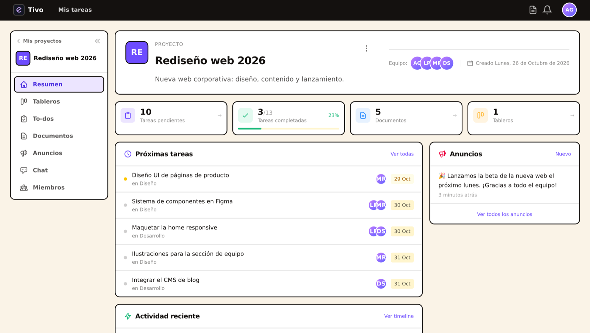
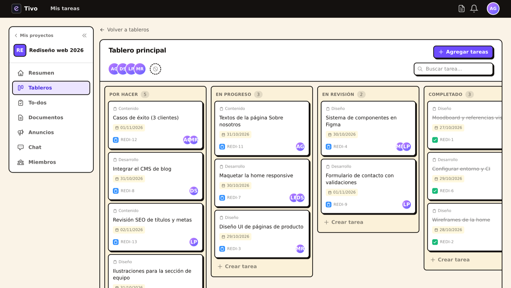
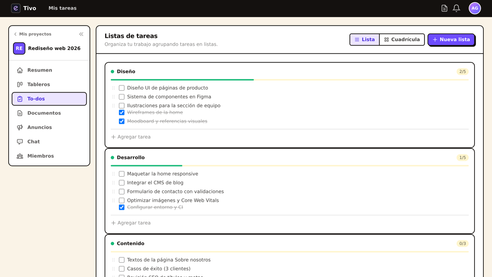
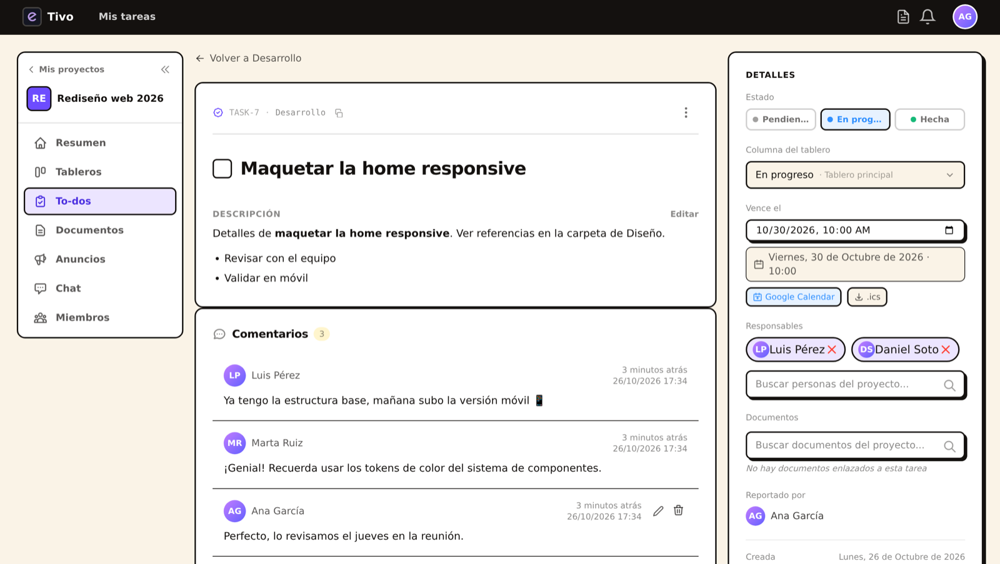
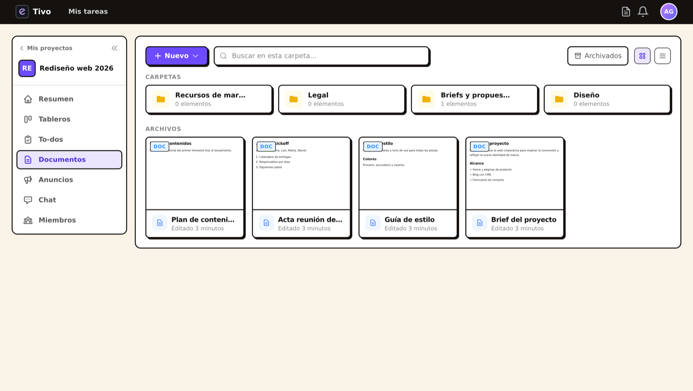
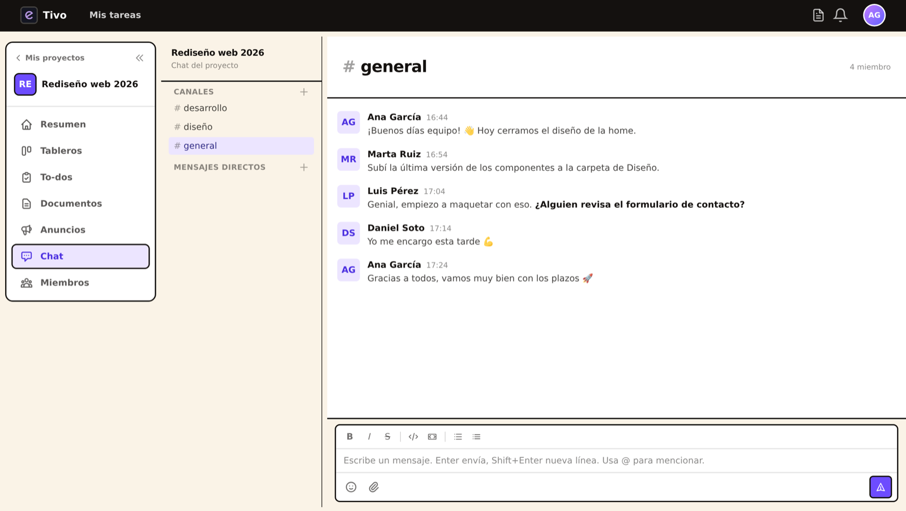
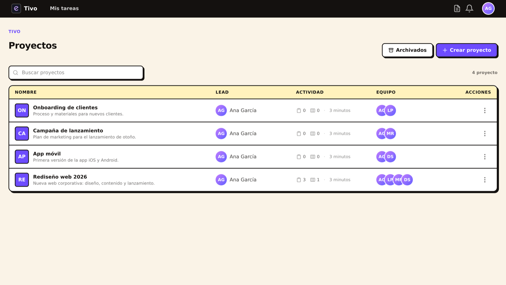

# Tivo

A collaborative project management app built with Rails 8. Create projects, manage tasks on kanban boards, chat with your team, and keep everything in one place.



## Screenshots

| Kanban board | Task lists |
|---|---|
|  |  |

| Task detail | Documents & folders |
|---|---|
|  |  |

| Team chat | Projects |
|---|---|
|  |  |

## Features

- **Projects & Tasks** — organize work into projects, todos, and tasks with status tracking
- **Kanban Board** — drag-and-drop columns (pending → in progress → done) synced with task status
- **Team Chat** — channels and direct messages with mentions, emoji reactions, and markdown support
- **Documents** — rich text editor with folder organization and file attachments
- **Announcements** — project-wide posts with comments
- **Notifications** — real-time web push notifications
- **Activity Feed** — audit trail of all changes across a project
- **Quick Notes** — personal sticky notes per user
- **Google OAuth** — sign in with Google in addition to email/password

## Tech Stack

- **Rails 8** with Hotwire (Turbo + Stimulus) — no Node.js build step
- **Tailwind CSS 4.x** for styling
- **MySQL 8** (development & production), SQLite (test)
- **Solid Stack** — Solid Queue, Cache, and Cable (database-backed, no Redis needed)
- **Active Storage** + AWS S3 for file uploads
- **Devise** for authentication with Google OAuth2

## Prerequisites

- Ruby 3.3.4
- Docker (for the MySQL database)

## Local Development

```bash
# 1. Clone the repo
git clone <repo-url>
cd tivo

# 2. Start the MySQL container
docker-compose -f local.yml up -d

# 3. Install dependencies and set up the database
bin/setup

# 4. Start the server with Tailwind watcher
bin/dev
```

Then visit [http://localhost:3000/users/sign_up](http://localhost:3000/users/sign_up) to register the first user.

### Running everything with Docker

If you'd rather not install Ruby or the MySQL client locally, `local.yml` also runs the app (Rails + Tailwind watcher) in a container:

```bash
docker compose -f local.yml up --build
```

The app is served at [http://localhost:3000](http://localhost:3000). The first boot installs gems into a named volume and runs `db:prepare`.

### Regenerating the README screenshots

The screenshots in `docs/screenshots` come from fictional demo data. With the Docker setup running:

```bash
docker compose -f local.yml exec web bin/rails runner script/screenshots/demo_seed.rb
docker compose -f local.yml exec web gem install ferrum
docker compose -f local.yml exec web ruby script/screenshots/capture.rb projects /projects project /projects/2 board /projects/2/boards/1 todos /projects/2/todos task /projects/2/todos/2/tasks/7 documents /projects/2/folders chat /projects/2/channels/1
```

`demo_seed.rb` prints the project, board, task and channel ids to use in the paths. Captures are taken at 2x; they were resized to 1600px wide with `sips -Z 1600`. Turn off `annotate_rendered_view_with_filenames` in `config/environments/development.rb` while capturing, or rich-text previews show the template comments.

### Environment Variables

Copy `.env.example` to `.env` and fill in the values (if applicable), or configure directly:

| Variable | Description |
|---|---|
| `DB_NAME` | Database name (default: `tebook_local_db`) |
| `DB_USERNAME` | MySQL user (default: `expressativo`) |
| `DB_PASSWORD` | MySQL password (default: `expressativo`) |
| `DB_HOST` | MySQL host (default: `127.0.0.1`) |
| `DB_PORT` | MySQL port (default: `3306`) |
| `GOOGLE_CLIENT_ID` | Google OAuth client ID |
| `GOOGLE_CLIENT_SECRET` | Google OAuth client secret |

## Testing

```bash
# Run all tests
bin/rails test

# Run a specific test file
bin/rails test test/models/project_test.rb

# Run system tests
bin/rails test:system
```

Tests use SQLite — no database container needed.

## Code Quality

```bash
bin/rubocop        # Lint
bin/rubocop -a     # Auto-correct
bin/brakeman       # Security scan
```

## Troubleshooting

If styles aren't loading after changes:

```bash
bin/rails tmp:cache:clear
bin/rails assets:clobber
bin/rails assets:precompile
```

## Production

The app ships as a Docker image. After deploying, run migrations manually:

```bash
rails db:migrate
```

Required production environment variables: `RAILS_MASTER_KEY`, `DB_*` credentials, `AWS_*` for S3, and a Resend API key for email.
